# Numerical Simulation of Stokes Flows with the Finite Element Method ($`P^2`$–$`P^1`$)

A from-scratch Python implementation of the Finite Element Method (FEM) to solve the scalar Poisson problem and the coupled incompressible Stokes equations for viscous flows, using Taylor–Hood elements.

> **Academic context:** developed for the *ANN1 — Méthode des éléments finis* course (ENSTA Paris, 2026–2027), in collaboration with **David Bernal**.

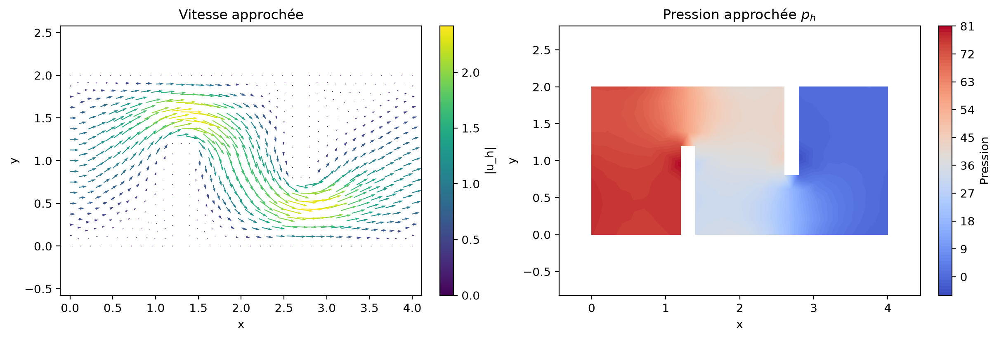
*Velocity field and pressure for Stokes flow in a channel with baffles.*

---

## Table of contents

1. [Physical background](#1-physical-background)
2. [Mathematical formulation](#2-mathematical-formulation)
3. [Implementation](#3-implementation)
4. [Results](#4-results)
5. [Stability experiment: why not $`P^1`$–$`P^1`$?](#5-stability-experiment-why-not-p1p1)
6. [Limitations and possible extensions](#6-limitations-and-possible-extensions)
7. [Repository structure and local execution](#7-repository-structure-and-local-execution)

---

## 1. Physical background

This project models **Stokes flow** (*creeping flow*), which governs viscous, incompressible fluids at **low Reynolds number** ($`Re \ll 1`$), as in microfluidics, lubrication, lava flows or microorganism locomotion.

When $`Re \ll 1`$, viscous forces overwhelm inertial forces by orders of magnitude, so the non-linear convective term of the Navier–Stokes equations, $`(\mathbf{u}\cdot\nabla)\mathbf{u}`$, becomes negligible. The resulting flow is:

- **linear** in the data (doubling the inlet velocity doubles the whole solution),
- **purely dissipative** and kinematically reversible,
- free of turbulent wakes and recirculation zones caused by inertia.

---

## 2. Mathematical formulation

### 2.1 Strong form

On a bounded polygonal domain $`\Omega \subset \mathbb{R}^2`$ with boundary $`\Gamma = \Gamma_D \cup \Gamma_N`$, we solve the steady Stokes problem for the velocity $`\mathbf{u}`$ and the pressure $`p`$:

```math
\begin{cases}
-\nu \Delta \mathbf{u} + \nabla p = \mathbf{f} & \text{in } \Omega \quad \text{(momentum conservation)} \\
\nabla \cdot \mathbf{u} = 0 & \text{in } \Omega \quad \text{(incompressibility)} \\
\mathbf{u} = \mathbf{g} & \text{on } \Gamma_D \quad \text{(Dirichlet: inlet, no-slip walls)} \\
\nu\, \partial_n \mathbf{u} - p\,\mathbf{n} = \mathbf{0} & \text{on } \Gamma_N \quad \text{(Neumann: free outlet)}
\end{cases}
```

### 2.2 Weak (variational) formulation

Multiplying by test functions $`(\mathbf{v}, q)`$ and integrating by parts (Green's formula) gives: find $`(\mathbf{u}, p) \in \mathbf{V}_g \times Q`$ such that

```math
\begin{aligned}
\nu \int_{\Omega} \nabla \mathbf{u} : \nabla \mathbf{v} \, d\Omega - \int_{\Omega} p \, (\nabla \cdot \mathbf{v}) \, d\Omega &= \int_{\Omega} \mathbf{f} \cdot \mathbf{v} \, d\Omega, & \forall \mathbf{v} &\in \mathbf{V}_0, \\
-\int_{\Omega} q \, (\nabla \cdot \mathbf{u}) \, d\Omega &= 0, & \forall q &\in Q,
\end{aligned}
```

with $`\mathbf{V}_g = \{\mathbf{u} \in (H^1(\Omega))^2 : \mathbf{u}|_{\Gamma_D} = \mathbf{g}\}`$, $`\mathbf{V}_0 = (H^1_{0,D}(\Omega))^2`$ and $`Q = L^2(\Omega)`$.

Integrating by parts lowers the regularity required of the solution from second to first derivatives ($`H^1(\Omega)`$). It also lets **natural (Neumann) boundary conditions** be built into the formulation: on $`\Gamma_N`$ the boundary term vanishes, which gives a "free outlet" for free. **Essential (Dirichlet) conditions** are imposed directly in the solution space $`H^1_{0}(\Omega)`$ (or its affine shift $`H^1_g`$).

The minus sign in the second equation keeps the discrete system **symmetric**.

### 2.3 Mixed stability and Taylor–Hood elements ($`P^2`$–$`P^1`$)

Velocity and pressure spaces cannot be chosen independently. Equal-order interpolation (e.g. $`P^1`$–$`P^1`$) violates the **LBB (Ladyzhenskaya–Babuška–Brezzi, or *inf-sup*) condition**

```math
\inf_{q_h} \sup_{\mathbf{v}_h} \frac{\int_\Omega q_h \, \nabla\cdot\mathbf{v}_h \, d\Omega}{\lVert \mathbf{v}_h \rVert_{H^1} \, \lVert q_h \rVert_{L^2}} \ \geq\ \beta > 0, \qquad \beta \text{ independent of } h,
```

and triggers non-physical spurious pressure oscillations (*checkerboard modes*). To guarantee stability and optimal convergence we use **Taylor–Hood ($`P^2`$–$`P^1`$)** mixed elements:

- **Velocity** ($`\mathbf{u}_h \in P^2`$, each component): piecewise quadratic and continuous, **6 degrees of freedom per triangle** (3 vertices + 3 edge midpoints). This is rich enough to satisfy the divergence constraint.
- **Pressure** ($`p_h \in P^1`$): piecewise linear and continuous, **3 degrees of freedom per triangle** (vertices only).

### 2.4 Discrete saddle-point system

With the unknown vector ordered as $`\vec U = [\,\vec u_1,\ \vec u_2,\ \vec p\,]^T \in \mathbb{R}^{2N + N_s}`$ ($`N`$ = number of nodes, $`N_s`$ = number of vertices), the system reads

```math
\mathbb{A}\vec U = \vec L, \qquad
\mathbb{A} =
\begin{bmatrix}
\nu \mathbb{K} & 0 & \mathbb{E} \\
0 & \nu \mathbb{K} & \mathbb{F} \\
\mathbb{E}^T & \mathbb{F}^T & 0
\end{bmatrix},
```

where $`\mathbb{K}`$ is the $`P^2`$ stiffness matrix and $`\mathbb{E}`$, $`\mathbb{F}`$ are the rectangular $`P^2`$–$`P^1`$ coupling blocks:

```math
\mathbb{K}_{IJ} = \int_\Omega \nabla w_J \cdot \nabla w_I \, d\Omega, \qquad
\mathbb{E}_{I\tilde J} = -\int_\Omega \tilde w_{\tilde J} \, \frac{\partial w_I}{\partial x} \, d\Omega, \qquad
\mathbb{F}_{I\tilde J} = -\int_\Omega \tilde w_{\tilde J} \, \frac{\partial w_I}{\partial y} \, d\Omega,
```

with $`(w_I)`$ the $`P^2`$ basis and $`(\tilde w_{\tilde J})`$ the $`P^1`$ basis.

---

## 3. Implementation

The solver was built incrementally, validating every layer before adding the next.

### 3.1 Scalar validation: Poisson equation in $`P^2`$

We first implemented the problem $`-\Delta u + u = f`$ (Neumann, then Dirichlet) as a testbed for all the FEM machinery.

**Step 1 — Mesh.** Second-order triangular meshes are generated with the Gmsh Python API, so nodes sit on the triangle vertices *and* on the edge midpoints.

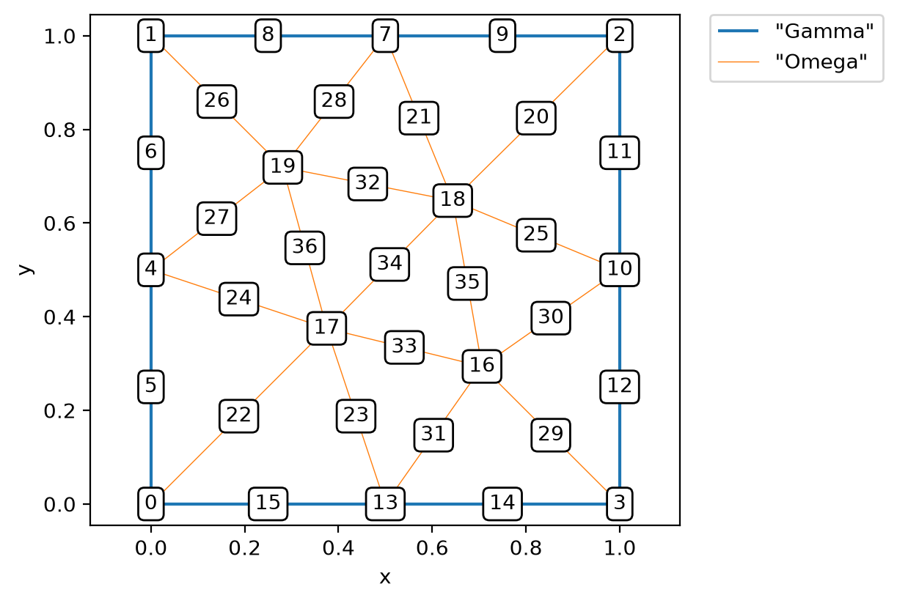
*$`P^2`$ mesh of $`]0,3[\times]0,2[`$. Dots mark the degrees of freedom (vertices and edge midpoints).*

**Step 2 — Elementary matrices.** Each triangle $`T_\ell`$ is mapped from the reference triangle $`\hat T`$ through the affine map $`\mathcal{F}_\ell(\hat M) = \mathcal{B}_\ell \hat M + b_\ell`$, with

```math
\mathcal{B}_\ell = \begin{bmatrix} x_2 - x_1 & x_3 - x_1 \\ y_2 - y_1 & y_3 - y_1 \end{bmatrix}, \qquad b_\ell = \begin{bmatrix} x_1 \\ y_1 \end{bmatrix}.
```

The $`P^2`$ basis functions are written with the barycentric coordinates $`\lambda_1, \lambda_2, \lambda_3`$:

```math
w_i = \lambda_i (2\lambda_i - 1) \ (i = 1,2,3), \qquad w_4 = 4\lambda_1\lambda_2, \quad w_5 = 4\lambda_2\lambda_3, \quad w_6 = 4\lambda_3\lambda_1 .
```

Elementary matrices are computed on $`\hat T`$ with numerical quadrature:

```math
\mathbb{M}^\ell_{ij} = \lvert\det \mathcal{B}_\ell\rvert \sum_q \hat c^q \, \hat w_i(\hat S^q)\, \hat w_j(\hat S^q), \qquad
\mathbb{K}^\ell_{ij} = \lvert\det \mathcal{B}_\ell\rvert \sum_q \hat c^q \, \big[\mathcal{B}_\ell^{-T}\hat\nabla \hat w_i\big]\cdot\big[\mathcal{B}_\ell^{-T}\hat\nabla \hat w_j\big](\hat S^q).
```

The **6-point rule (order 4)** is exact for the mass matrix (degree-4 integrand), and the **3-point rule (order 2)** is exact for the stiffness and coupling matrices (degree-2 integrands).

**Step 3 — Global assembly.** Elementary matrices are scattered into global sparse matrices using the node indexing of the mesh. The matrices are sparse, so they are cheap to store and to solve.

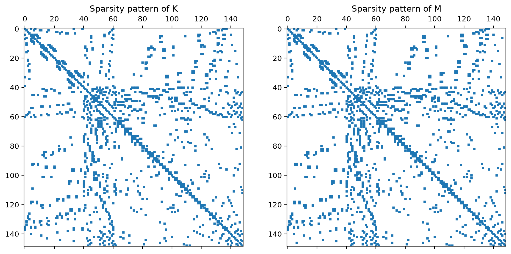
*Sparsity pattern of $`\mathbb{K}`$ and $`\mathbb{M}`$.*

**Step 4 — Solve.** The sparse linear system is solved with a direct sparse solver (`src.sparse_solve`).

**Step 5 — Error study.** We compare against a manufactured trigonometric solution on several mesh sizes, using the matrices themselves to compute the norms:

```math
\lVert u - u_h \rVert_{L^2} \simeq \sqrt{\vec E^T \mathbb{M} \vec E}, \qquad
\lvert u - u_h \rvert_{1} \simeq \sqrt{\vec E^T \mathbb{K} \vec E}, \qquad \vec E = \vec U_{ex} - \vec U .
```

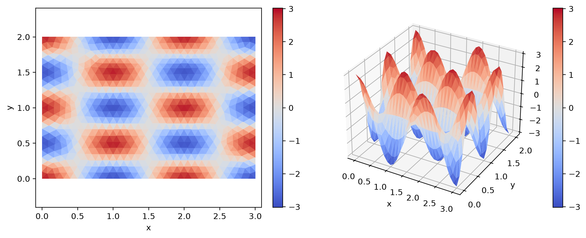
*Manufactured solution $`u = 3\cos(\pi x)\cos(2\pi y)`$ and its FEM approximation.*

**Step 6 — Dirichlet conditions by pseudo-elimination.** Rows of $`\mathbb{A}`$ associated with boundary nodes are zeroed, the diagonal is set to $`\rho = 1`$, and the right-hand side is set to $`0`$ (homogeneous) or to $`g(M_J)`$ (non-homogeneous):

```math
\tilde{\mathbb{A}} = \begin{bmatrix} \mathbb{A}_{II} & \mathbb{A}_{IB} \\ 0 & \mathbb{I} \end{bmatrix}, \qquad
\tilde{L} = \begin{bmatrix} \vec L_I \\ \vec g \end{bmatrix}.
```

Keeping the block $`\mathbb{A}_{IB}`$ unchanged transfers the boundary contribution to the right-hand side of the interior equations. The matrix is no longer symmetric, which a sparse direct (LU) solver does not mind.

### 3.2 Stokes solver ($`P^2`$–$`P^1`$ Taylor–Hood)

The Stokes solver reuses the same pipeline, with block assembly:

**Mesh → elementary matrices ($`\mathbb{K}`$, $`\mathbb{E}`$, $`\mathbb{F}`$) → block global assembly → pseudo-elimination → solve**

- **Vertex/node numbering.** Gmsh does not number vertices before edge midpoints, so we build a vertex ↔ node map (`numerotation_sommets_noeuds`) to assemble the rectangular $`P^2`$–$`P^1`$ blocks correctly.
- **Pseudo-elimination.** Applied on $`\Gamma_D`$ for *both* velocity components. The Neumann outlet is natural and needs no treatment.
- **Validation with Poiseuille flow.** The solver is compared with the exact parabolic solution on $`[0, L_x]\times[0, H]`$:

```math
u_1 = \frac{G}{2\nu}\, y\,(H - y), \qquad u_2 = 0, \qquad p = G\,(L_x - x).
```

- **Other domains.** Backward-facing step, baffled channel and L-shaped domain, to observe different physical behaviours.

---

## 4. Results

### 4.1 Poisson convergence

| Boundary condition | $`L^2`$ slope (theory: 3) | $`H^1`$ slope (theory: 2) |
|---|---|---|
| Neumann | 3.86 | 2.68 |
| Homogeneous Dirichlet | 3.76 | 2.66 |

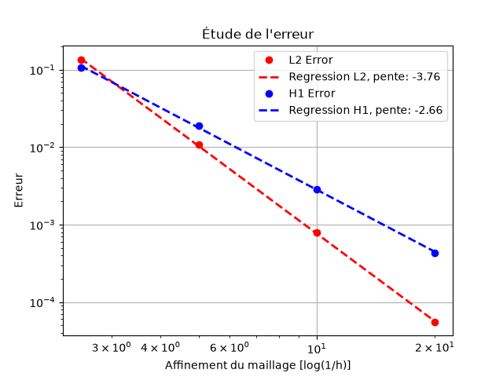
*Log–log convergence of the $`L^2`$ and $`H^1`$ errors for the $`P^2`$ Poisson solver.*

Slopes are at least as good as the theoretical orders $`h^{k+1}`$ in $`L^2`$ and $`h^k`$ in $`H^1`$ for $`P^k`$ elements ($`k=2`$), and one order better than the $`P^1`$ elements of the previous lab. They are slightly above theory because we measure $`\pi_h u - u_h`$ (distance to the *interpolant*), which does not contain the interpolation error inside the triangles. The Dirichlet condition is imposed exactly at the boundary nodes, so it does not degrade the order.

### 4.2 Poiseuille flow (validation)

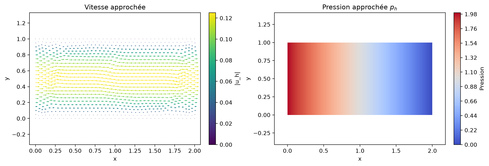
*Approximate velocity (arrows) and pressure for Poiseuille flow.*

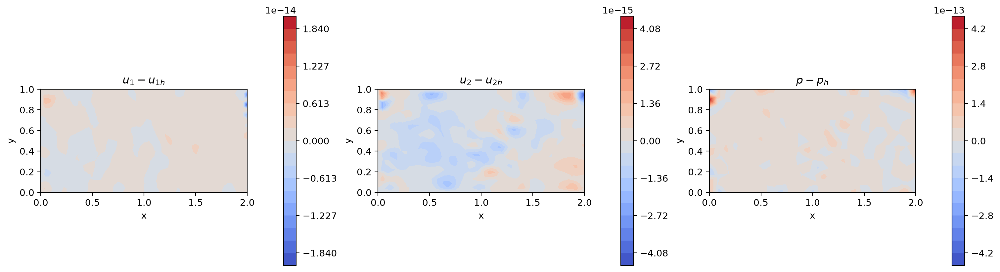
*Differences $`u_1 - u_{1h}`$, $`u_2 - u_{2h}`$ and $`p - p_h`$.*

We recover the parabolic profile and an affine pressure. The errors are at **machine-precision level** ($`\sim 10^{-14}`$ for the velocity, $`\sim 10^{-13}`$ for the pressure). This is expected: the exact solution (quadratic velocity, affine pressure) lies *inside* the discrete space $`P^2`$–$`P^1`$, so the discrete solution coincides with the exact one. The test therefore validates the assembly, the vertex/node numbering, the pseudo-elimination on both velocity components and the natural outlet condition. It cannot measure a convergence rate, which is why we add the manufactured-solution study below.

### 4.3 Test geometries

#### Backward-facing step

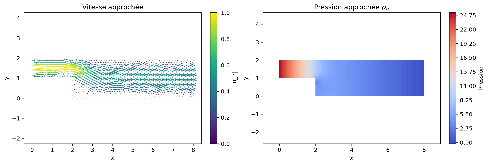
*Velocity and pressure in the backward-facing step.*

The solution is qualitatively consistent with the physics: high pressure at the inlet, zero velocity on the walls (no-slip), and accelerated flow in the narrow section. We also verified **mass conservation** quantitatively: inflow $`= 2/3 \approx 0.6667`$ and outflow $`\approx 0.6641`$ (the small gap is a discretisation effect).

#### Baffled channel (viscosity study)


*Flow weaving around the baffles ($`\nu = 1`$ and $`\nu = 0.01`$ give the same velocity field).*

In this more complex flow the fluid weaves around the obstacles and accelerates as it passes them. Since $`\mathbf{f} = 0`$ and the velocity is prescribed on the boundary, the velocity field is **independent of $`\nu`$** and the pressure scales linearly with it: if $`(\mathbf{u}, p)`$ solves the problem for $`\nu = 1`$, then $`(\mathbf{u}, \nu p)`$ solves it for viscosity $`\nu`$. We checked this numerically: the velocity difference between $`\nu=1`$ and $`\nu=0.01`$ is $`\sim 10^{-14}`$, and $`p_{\nu=1} - 100\,p_{\nu=0.01} \sim 10^{-12}`$.

#### L-shaped domain (re-entrant corner)

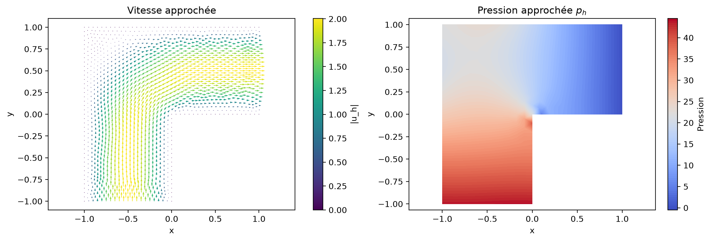
*Velocity and pressure around the re-entrant corner of the L-shaped domain.*

This domain was implemented to observe the behaviour near a corner. The solution varies non-linearly close to the re-entrant corner because the solution is not regular there (a geometric singularity). Locally refining the mesh in that region would be needed to recover optimal accuracy.

We also verified the **linearity** of the problem: doubling the inlet amplitude gives $`\mathbf{u}`$ and $`p`$ exactly doubled (difference $`0.0`$), and the flow-rate balance holds (inflow $`=`$ outflow $`= 0.665`$ for $`U=1`$, against $`2U/3 \approx 0.667`$ expected).

Across all three geometries, no recirculation zone appears behind the step, the baffles or in the elbow, because there is no convective term. This is the opposite of what happens at high Reynolds number.

### 4.4 Stokes convergence study (manufactured solution)

To measure convergence rates, we use a smooth non-polynomial solution on $`\Omega = ]0,1[^2`$ built from a stream function, which makes $`\nabla\cdot\mathbf{u} = 0`$ hold by construction:

```math
\psi(x,y) = \sin^2(\pi x)\sin^2(\pi y), \qquad
u_1 = \partial_y \psi, \quad u_2 = -\partial_x \psi, \quad p = \sin(\pi x)\cos(\pi y).
```

The velocity vanishes on the whole boundary ($`\Gamma_D = \Gamma`$, $`\Gamma_N = \emptyset`$), and the source term $`\mathbf{f} = -\nu\Delta\mathbf{u} + \nabla p`$ is computed symbolically (SymPy) and interpolated at the nodes. Since $`\Gamma_N = \emptyset`$, the pressure is only defined up to a constant, so we **pin $`p_h`$ at one vertex** and compare $`p`$ and $`p_h`$ after removing their means.

| Relative error | Estimated order | Theoretical order |
|---|---|---|
| $`\lVert \mathbf{u} - \mathbf{u}_h \rVert_{L^2}`$ | 3.68 | 3 |
| $`\lvert \mathbf{u} - \mathbf{u}_h \rvert_{1}`$ | 2.55 | 2 |
| $`\lVert p - p_h \rVert_{L^2}`$ | 2.58 | 2 |

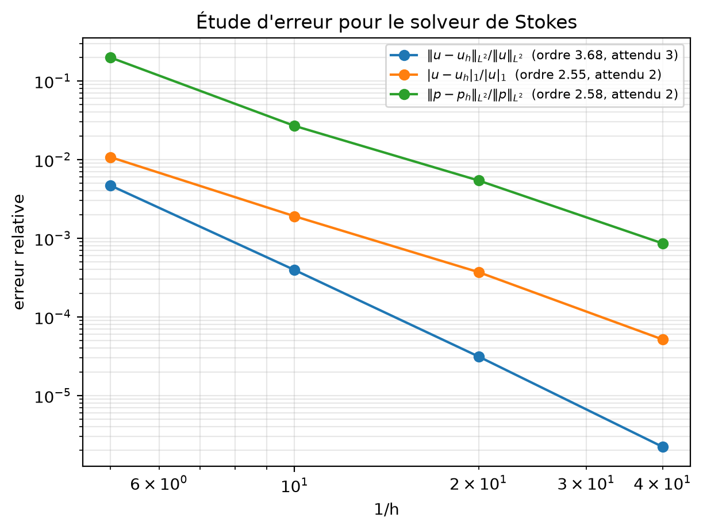
*Log–log convergence of the Stokes solver for $`h \in \{0.2, 0.1, 0.05, 0.025\}`$.*

All orders are at least the theoretical Taylor–Hood orders. This validates the whole chain (elementary matrices, assembly, pseudo-elimination, right-hand side). The slightly higher observed orders are consistent with a very smooth solution and with theory providing guaranteed upper bounds.

---

## 5. Stability experiment: why not $`P^1`$–$`P^1`$?

To illustrate the LBB condition, we also adapted the code to $`P^1`$–$`P^1`$ elements. On a first-order mesh all nodes are vertices, so velocity and pressure both have $`N`$ unknowns (system of size $`3N`$), the elementary matrices need no quadrature ($`\nabla\lambda_i`$ is constant and $`\int_T \lambda_j = \lvert T \rvert / 3`$), and block assembly and pseudo-elimination are unchanged.

On the Poiseuille flow, the velocity error decreases with $`h`$ (from $`\sim 10^{-2}`$ to $`\sim 10^{-4}`$ between $`h = 0.2`$ and $`h = 0.025`$), but **the pressure does not converge**: its maximum error stays between 0.3 and 3 for an exact pressure ranging from 0 to 2, with vertex-to-vertex oscillations.

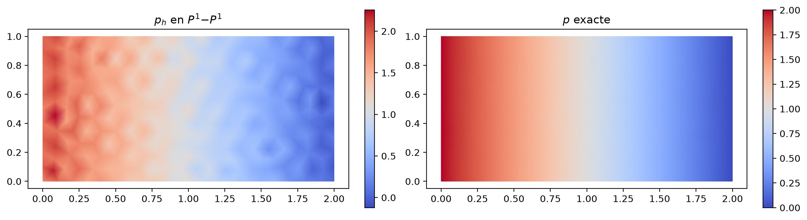
*Left: $`P^1`$–$`P^1`$ pressure (spurious oscillations). Right: exact pressure.*

The pair fails the discrete inf-sup condition: there exist oscillating pressures $`q_h`$ with $`\int_\Omega q_h \nabla\cdot\mathbf{v}_h \approx 0`$ for every $`\mathbf{v}_h`$, so the scheme cannot control them. With Taylor–Hood, the extra edge-midpoint degrees of freedom enrich the velocity space, the condition holds, and the pressure converges at the expected order.

---

## 6. Limitations and possible extensions

- **Local mesh refinement** near re-entrant corners (step, baffles, L-shaped domain), where the solution is singular.
- **Non-homogeneous Dirichlet** convergence study with a reference solution that is non-zero on the boundary.
- **Convective term:** extending the solver to Navier–Stokes (Picard/Newton iterations) to go beyond $`Re \ll 1`$.

---

## 7. Repository structure and local execution

```text
├── stokes_fem_solver.ipynb     # Full implementation, derivations and visualizations
├── src/                        # Auxiliary mesh-parsing modules (Gmsh wrapper)
├── images/                     # Exported figures used in this README
└── requirements.txt            # Python environment dependencies
```

```bash
git clone <your-repository-url>
cd <your-repository-name>
pip install -r requirements.txt
jupyter notebook stokes_fem_solver.ipynb
```

Main dependencies: `numpy`, `scipy`, `matplotlib`, `sympy` and `gmsh`.

---

## Authors

**Igor de Araujo** and **David Felipe Bernal Muñoz**, ENSTA Paris.
